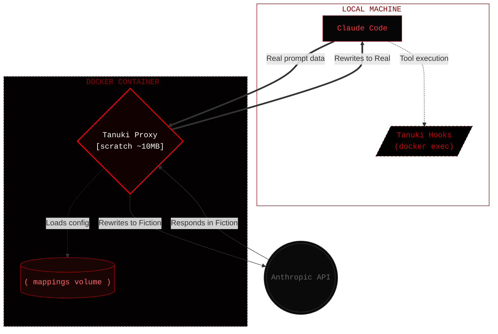

<div align="center">

# Tanuki


<i>"The greatest craft is to hide craft."</i><br/>
<sub>Thomas Fuller</sub>

**Proxy for AI-assisted security testing/privacy**

[](https://github.com/Pigyon/tanuki/releases/latest)
[](https://github.com/Pigyon/tanuki/actions/workflows/ci.yml)
[](https://github.com/Pigyon/tanuki/pkgs/container/tanuki)

[](https://go.dev)
[](https://www.docker.com/)
[](#quick-start)
[](#architecture)
[](LICENSE)

</div>

---

Tanuki sits between your local **Claude Code** agent and the **Anthropic API**, rewriting every target-identifying string in real time. Your tools hit the real target; the model only ever sees a fictional localhost project.

## Table of Contents

- [Overview](#overview)
- [How it works](#how-it-works)
- [Example](#example)
- [Quick start](#quick-start)
- [Configuration](#configuration)
  - [Scope](#scope)
- [CLI reference](#cli-reference)
- [What gets rewritten](#what-gets-rewritten)
- [Environment variables](#environment-variables)
- [Architecture](#architecture)
- [Verifying an engagement](#verifying-an-engagement)
- [Known limitations](#known-limitations)
- [Fail-closed behaviour](#fail-closed-behaviour)
- [Disclaimer](#disclaimer)
- [License](#license)

## Overview

Tanuki is an anonymization proxy built for AI-assisted security testing and bug bounty hunting. When you drive an agent like Claude Code through a pentest, every real domain, IP, and payload in your prompts leaves your machine. That's an OpSec risk, and it can also breach bug bounty program rules or an NDA.

Tanuki runs as a Docker container and transparently intercepts that API traffic. Before a prompt leaves your machine, it swaps real target data (domains, subdomains, IPs, emails, paths, cloud identifiers, AWS account IDs, and aggressive security terminology) for harmless fictional development equivalents. When the model responds, the fiction is mapped back to reality so your local tools execute against the real targets. The model believes it is helping you debug a local dev application, and the upstream provider is blind to your actual engagement.

## How it works



| Direction      | Path                    | What happens                                                                                                                                                             |
| -------------- | ----------------------- | ------------------------------------------------------------------------------------------------------------------------------------------------------------------------ |
| **Inbound**    | your prompt → API       | Domains, org names, emails, IPs, paths, cloud identifiers, and pentest terminology are replaced with localhost fiction before the model sees them.                       |
| **Outbound**   | API → Claude Code       | Fiction terms are rewritten back to real values in the response stream, so Claude Code's local tools receive real target data.                                           |
| **Tool calls** | hook via `docker exec`  | A `PreToolUse` hook rewrites fiction→real in tool arguments, so tools hit the actual targets. Tool output needs no hook: it reaches the model only inside the next request, which the proxy rewrites like any other. |

## Example

You're testing `bounty.amazon.com`. Here's what Tanuki does:

| You type (real)         | LLM sees (fiction)           |
| ----------------------- | ---------------------------- |
| `amazon.com`            | `localhost:9000`             |
| `bounty.amazon.com`     | `localhost:9002`             |
| `any-other.amazon.com`  | `localhost:9001` (wildcard)  |
| `admin@amazon.com`      | `admin@devtarget.local`      |
| `Amazon`                | `DEVTARGET`                  |
| `52.94.236.248`         | `127.0.0.3`                  |
| `arn:aws:iam::123456789012:role/x` | `arn:aws:iam::000000000001:role/x` |
| `/var/www/amazon/`      | `/var/www/dev/devtarget/`    |
| `s3://amazon-prod`      | `file:///tmp/devtarget-prod` |
| `SQL injection`         | `parameterized query test`   |
| `reverse shell`         | `remote debug session`       |

Each target domain gets three mappings: the base domain, a wildcard for
subdomains that have not been seen yet, and a dedicated mapping per
subdomain as it is detected. The wildcard is what stops an unmapped host
like `internal-admin.amazon.com` from leaking its label upstream.

## Quick start

```bash
git clone https://github.com/Pigyon/tanuki.git
cd tanuki
docker compose up -d
claude
```

That pulls the latest published image from GitHub Container Registry, so no Go toolchain and no build are needed.

To build from source instead of pulling:

```bash
docker compose -f compose.yaml -f compose.dev.yaml up -d --build
```

On startup the proxy auto-configures the Claude Code hook and proxy env in `.claude/settings.json`, and writes the cover-story `.claude/CLAUDE.md`. Domains, emails, and IPs are **auto-detected** from your conversation, so no manual target configuration is needed.

When you type _"check bounty.amazon.com for SQL injection"_, the proxy:

1. Detects `amazon.com` and `bounty.amazon.com` as new domains
2. Creates all derivative mappings (org, email, path, cloud)
3. Rewrites the request before it reaches the API

### Wrapper script

A `./tanuki` wrapper is included so you don't have to type `docker compose exec tanuki /tanuki <command>`:

```bash
./tanuki add example.com
./tanuki map
./tanuki status
```

### Verify rewriting

Test the rewriting engine without hitting the API:

```bash
./tanuki test "scan bounty.amazon.com for SQL injection and contact admin@amazon.com"
```

## Configuration

Everything is optional; without it, targets are auto-detected from your conversation. To pre-configure an engagement, edit `compose.yaml`:

```yaml
environment:
  # Custom fiction org name (default: DEVTARGET)
  - TANUKI_FICTION_ORG=ACMECORP
  # Pre-seed target domains (comma-separated)
  - TANUKI_DOMAINS=example.com,api.example.com
  # Pre-seed target IPs (comma-separated)
  - TANUKI_IPS=93.184.216.34
  # Custom rewrite rules (semicolon-separated, pipe-delimited real|fiction)
  - TANUKI_RULES=John Smith|Jane Developer;Project Phoenix|Test Alpha
```

### Custom rewrite rules

For strings that aren't domains or IPs (people, project names, internal jargon), add custom rules via `compose.yaml` (applied on every container start) or at runtime:

```bash
./tanuki add-rule "John Smith" "Jane Developer"
./tanuki add-rule "Project Phoenix" "Test Alpha"
```

### Scope

A bug bounty program publishes what is in scope. Tell tanuki, and it treats
those domains as targets while anything else it detects is merely hidden:

```bash
./tanuki scope add '*.amazon.com'
./tanuki scope list
```

Adding a domain to the scope promotes it even if it was already mapped, so you
can set the scope part-way through an engagement. Removing one stops new domains
earning an org name, but keeps the mappings already made: the model has been
shown those fictions, so dropping them would leave its earlier replies
unreversible.

| | In scope | Detected, out of scope |
| --- | --- | --- |
| Hostname → `localhost:<port>` | yes | yes |
| Org, email, path, cloud mappings | yes | no |

The difference matters because an org mapping rewrites a bare word everywhere.
Without a scope, one `docs.python.org` in tool output makes `python` an org, and
`written in Python` reaches the model as `written in DEVTARGET2`. With a scope,
that domain still gets a hostname mapping, so nothing about it leaks, but the
word keeps its meaning.

With no scope set, a common TLD stands in for one, so an engagement without a
scope behaves as it always has. A domain recognised only by its context — any
real TLD after `://`, after `@`, or before a path — is hidden either way, but
never earns an org name on a guess that weak. `./tanuki add` always creates the
full set: it is an explicit statement that the domain is a target.

Pre-configure it in `compose.yaml` with `TANUKI_SCOPE=amazon.com,example.org`.

### Named engagements

For separate projects or custom fiction org names:

```bash
./tanuki init bugbounty --fiction-org ACMECORP
./tanuki add bounty.amazon.com
```

## CLI reference

All commands run via `./tanuki <command>` (or `docker compose exec tanuki /tanuki <command>`):

| Command                             | Description                                        |
| ----------------------------------- | -------------------------------------------------- |
| `setup`                             | Configure Claude Code hooks (automatic on startup) |
| `init <name> [--fiction-org NAME]`  | Create a named engagement                          |
| `add <domain> [--fiction-org NAME]` | Pre-seed a target domain                           |
| `add-ip <ip>`                       | Pre-seed an IP mapping                             |
| `add-account <id>`                  | Pre-seed an AWS account ID mapping                 |
| `scope [list]`                      | Show which domains are treated as targets          |
| `scope add <domain>`                | Add a domain to the engagement scope               |
| `scope rm <domain>`                 | Remove a domain from the scope                     |
| `add-rule <real> <fiction>`         | Add a custom rewrite rule                          |
| `map`                               | Show the current mapping table                     |
| `status`                            | Show engagement info                               |
| `list`                              | List all engagements                               |
| `activate <name>`                   | Switch the active engagement                       |
| `test <text>`                       | Test rewriting on sample text                      |
| `verify [file...\|-]`               | Check the mappings hold; scan files for unmapped targets |
| `terms`                             | Show terminology mappings                          |
| `export [name]`                     | Export an engagement as JSON                       |
| `import <file.json>`                | Import an engagement from JSON                     |
| `reset [--data]`                    | Remove hooks (`--data` also wipes engagements)     |
| `version`                           | Show version and build info                        |
| `proxy`                             | Run the proxy server (container entrypoint)        |

## What gets rewritten

### Mapping-based (per engagement, all auto-detected)

| Type            | Detection                              | Fiction                    |
| --------------- | -------------------------------------- | -------------------------- |
| Domains         | Auto-detected in prompts & tool output; any real TLD in a URL, after `@`, or with a path/port | `localhost:<port>`         |
| Org names       | In-scope domains, or a common TLD when no scope is set (see [Scope](#scope)); matched inside identifiers too (`acme_prod`, `AcmeCloud`) | `DEVTARGET` (configurable) |
| Emails          | Derived from domain                    | `user@devtarget.local`     |
| IPs (v4 + v6)   | Auto-detected in prompts & tool output | `127.0.0.x` / `::ffff:...` |
| Paths           | Derived from org name                  | `/dev/devtarget/`          |
| Cloud resources | Derived from org name                  | `file:///tmp/devtarget...` |
| AWS account IDs | In ARNs and `Account`/`account_id` fields | `000000000001`             |
| Custom rules    | User-defined via env or CLI            | User-defined               |

### Terminology (built-in, applied to all engagements)

Compound pentest-specific terms are replaced with neutral dev equivalents. Only unambiguous multi-word terms are replaced. Single words like _target_, _payload_, or _exploit_ are left alone so legitimate code discussions don't break.

Run `./tanuki terms` to see the full dictionary. The list lives in `internal/tanuki/terminology.json` and is embedded at build time; to customize it, edit the file and rebuild.

## Environment variables

Set in `compose.yaml`:

| Env var              | Default                     | Description                                              |
| -------------------- | --------------------------- | -------------------------------------------------------- |
| `TANUKI_DATA`        | `/data`                     | Engagement data directory (volume)                       |
| `TANUKI_PROXY_PORT`  | `18080`                     | Proxy listen port                                        |
| `TANUKI_PORT_START`  | `9000`                      | Starting port for domain assignments                     |
| `TANUKI_UPSTREAM`    | `https://api.anthropic.com` | Upstream API URL                                         |
| `TANUKI_FICTION_ORG` | `DEVTARGET`                 | Fiction org name for mappings. At least 4 characters, no whitespace, and not a public suffix: the gate recognises tanuki's own output by this name, so a value like `com` would switch it off |
| `TANUKI_DOMAINS`     | _(none)_                    | Comma-separated domains to pre-seed                      |
| `TANUKI_IPS`         | _(none)_                    | Comma-separated IPs to pre-seed                          |
| `TANUKI_SCOPE`       | _(none)_                    | Comma-separated in-scope domains (subdomains included). Empty means every detected domain is a target |
| `TANUKI_RULES`       | _(none)_                    | Custom rules: `real\|fiction` pairs, semicolon-separated |
| `TANUKI_IGNORE`      | _(none)_                    | Comma-separated domains never treated as targets (subdomains included). Always ignored: `anthropic.com`, `claude.com`, `claude.ai`, `json-schema.org`, the developer-platform domains Claude Code surfaces (`github.com`, `githubusercontent.com`, `google.com`, `googleapis.com`), and the operator's own email domain, read from Claude Code's account context in the system prompt and in your own messages (never from tool output or from the model's replies, so a page cannot forge one to exempt its own domain). If one of these is your real target, `./tanuki add <domain>` maps it explicitly |
| `TANUKI_UID` / `TANUKI_GID` | `1000`               | Owner for a `.claude/` directory Docker had to create; an existing one keeps its owner |
| `TANUKI_DEBUG`       | _(none)_                    | Set to any non-empty value to enable debug logging       |
| `TANUKI_ON_LEAK`     | `refuse`                    | `refuse` or `warn` when a real value survives the rewrite |

## Architecture

**Container:** `scratch`-based image with a single static Go binary plus CA certs. No OS, no shell, no runtime, ~10MB total. All capabilities dropped, read-only filesystem, no privilege escalation.

**Everything runs in Docker.** The proxy, hooks, and CLI all execute inside the container; hooks are invoked by Claude Code via `docker exec`, so no host-side binary is needed.

**Matching:** an Aho-Corasick automaton does longest-first replacement in a single pass over the stream.

**JSON-aware:** request and response bodies are rewritten string by string, never as raw text. Protocol fields (`model`, `role`, `type`, ids, tool names) are left alone, base64 data is neither rewritten nor scanned, and thinking blocks go back to the API exactly as the model wrote them, since they are signed.

## Known limitations

- **No HTTPS on the proxy.** The proxy listens on plain HTTP. It binds `0.0.0.0` inside the container, and what keeps it private is the published port in `compose.yaml`: `127.0.0.1:18080:18080`, which accepts only connections from the local machine. Removing that `127.0.0.1` prefix, or running the binary outside Docker, exposes an unauthenticated plaintext proxy to the network. The upstream connection to the Anthropic API uses HTTPS.
- **Literal string matching only.** Encoded forms (URL-encoded, base64, and similar) won't be caught by the Aho-Corasick automaton.
- **Terminology is one-directional.** Pentest terms are rewritten real→fiction only. The model's responses use fiction terms, which pass through as-is.
- **Wildcard subdomains are not reversible.** Every subdomain without its own mapping collapses onto a single wildcard value, so it cannot be mapped back. Auto-detection creates dedicated mappings for subdomains it sees, and those round-trip normally; the wildcard is the safety net for anything that slips past detection, and it favours hiding the hostname over keeping it usable.
- **Detection is the weak link, not the rewrite.** Every outbound body is re-scanned after rewriting and refused if a real value survives, so a rewriter bug that drops a *recognised* value is caught. The re-scan sees what detection sees, so it cannot catch a value neither of them recognises, and it skips what is never rewritten: base64 image and document data, and signed thinking blocks. The limitations below are therefore the ones that matter.
- **Words code is written with are not treated as hostnames.** `.net`, `.io`, `.at`, `.network`, `.global` and `.online` are real TLDs, so `using System.Net;`, `self.network` and `buffer.at(i)` are hostnames by shape alone. A bare token whose registrable name is an everyday word (`self`, `system`, `user`, `config`, `template`, …) is left alone, and package registries and documentation hosts (`golang.org`, `pypi.org`, `npmjs.com`, `docs.rs`, `stackoverflow.com`, the RFC 2606 `example.*` names) are ignored outright. If one of these is your real target, `./tanuki add <domain>` maps it explicitly.
- **A two-label bare token needs a common TLD, and a weakly detected one gets no org name.** Auto-detection reads a hostname on any real (ICANN) TLD where the surroundings say it is one — after `://` or `@`, or with a path right after it (`portal.acme.in/login`, `ops@acme.pl`, `acme.in:8443/admin`) — and also when a bare token has three or more labels (`api.target.in`, which is what subdomain enumeration output looks like). A two-label token standing on its own is held to a curated list of ~70 common TLDs, because attribute access and file references spell a real TLD often enough (`item.data.id`, `README.md:3`, `src/main.rs:118` — `.id`, `.md` and `.rs` are all real) that taking those as domains polluted the table. A domain recognised only by its context earns no org, email, path or cloud mapping, since an org rule rewrites a bare word everywhere. A bare two-label mention on an unusual TLD is still missed; add it with `./tanuki add`.
- **Ignored domains need an explicit `add` to become targets.** `github.com`, `google.com`, and your own email domain are skipped by auto-detection so Claude Code's own git remotes, connectors, and account context don't pollute the table. The trade-off is that auto-detection alone will not map one of these, so on the rare engagement that targets GitHub or Google you must `./tanuki add github.com` first; the residual check also skips ignored domains, so it will not catch the omission for you.
- **Thinking stays in fiction.** Thinking blocks are signed by the API, so they are passed through unchanged in both directions. Thinking shown in Claude Code reads in fiction terms.
- **Streamed text is held back briefly.** A fiction value can be streamed a few characters per event, so the proxy holds back the end of a text or tool-input block while it could still be the start of one, and sends it once the next event settles it. Display can lag by a few characters; the full value always arrives reversed.

## Verifying an engagement

`tanuki verify` answers two questions without sending anything anywhere.

**Do my mappings actually hold?** With no arguments it takes every real value in the table and puts it through the shapes a target takes in practice — bare, in a URL, inside backticks, as a markdown link, in a JSON field, in an HTTP header, upper-cased, at the end of a sentence — then checks the value is gone from each. A mapping that covers the bare string can still fail inside one of these, so it is worth running before an engagement starts rather than during it.

```console
$ ./tanuki verify
Verifying 8 mappings against 12 shapes

96 checks, 0 leaks
Every mapped value was rewritten in every shape.
```

**Is this document safe to send?** Given files, `-`, or a `< file` redirect, it rewrites the text and reports the real-looking values that no mapping covers. This is the check to run over a draft report before it is submitted.

```console
$ ./tanuki verify report.md
  LEAK  report.md
        partner-portal.acme-supplier.io
        93.184.216.34

2 value(s) have no mapping and would be sent as-is.
Add them with: tanuki add <domain> / tanuki add-ip <ip> / tanuki add-account <id>
```

It exits non-zero when it finds something, so it drops into a pre-submission hook or CI as-is.

## Fail-closed behaviour

The proxy will not forward a prompt it cannot anonymize.

**Every body is checked after it is rewritten.** The last thing that happens before a `/v1/messages` request leaves is a re-scan for anything that still looks like a real target, and for any mapped org name or custom-rule value the rewrite left behind. If one survived, the request is refused with `400` and the value is written to the tanuki log — never into the HTTP response, which the client may fold into its next prompt. In a working pipeline this never fires; when it does, it means the rewriter missed something and the body must not go upstream.

**Targets are mapped wherever they first appear.** The proxy runs detection over every outbound body, so a target in the prompt you type, in tool output, in an `@`-mentioned file, a paste, `CLAUDE.md`, a session resumed elsewhere, or from any client that is not Claude Code gets a fiction before the rewrite rather than travelling upstream in the clear.

A request is also refused when there is no active engagement, or the mapping table is unreadable, or the table is empty and the body holds nothing recognisable. A brand-new engagement no longer blocks: the first request naming a target maps it and forwards the anonymized body.

Set `TANUKI_ON_LEAK=warn` to log a surviving value and forward anyway. That trades the guarantee for uptime, and is meant for diagnosing a false positive, not for normal use.

> The check inherits detection's blind spots: it recognises the same curated TLD list and the same literal forms, so a target on an unusual TLD or in an encoded form is invisible to both. It catches rewriter failures, not detector failures.

## Disclaimer

Tanuki is intended for authorized security testing only: engagements you have written permission to perform, such as an in-scope bug bounty program or a contracted pentest. It reduces the exposure of target data to third-party model providers; it is not a guarantee of anonymity and does not exempt you from any program rules, NDA, or law. You are responsible for how you use it.

## License

Apache 2.0
